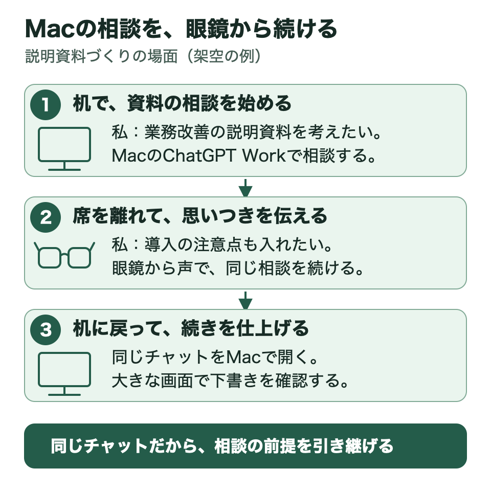
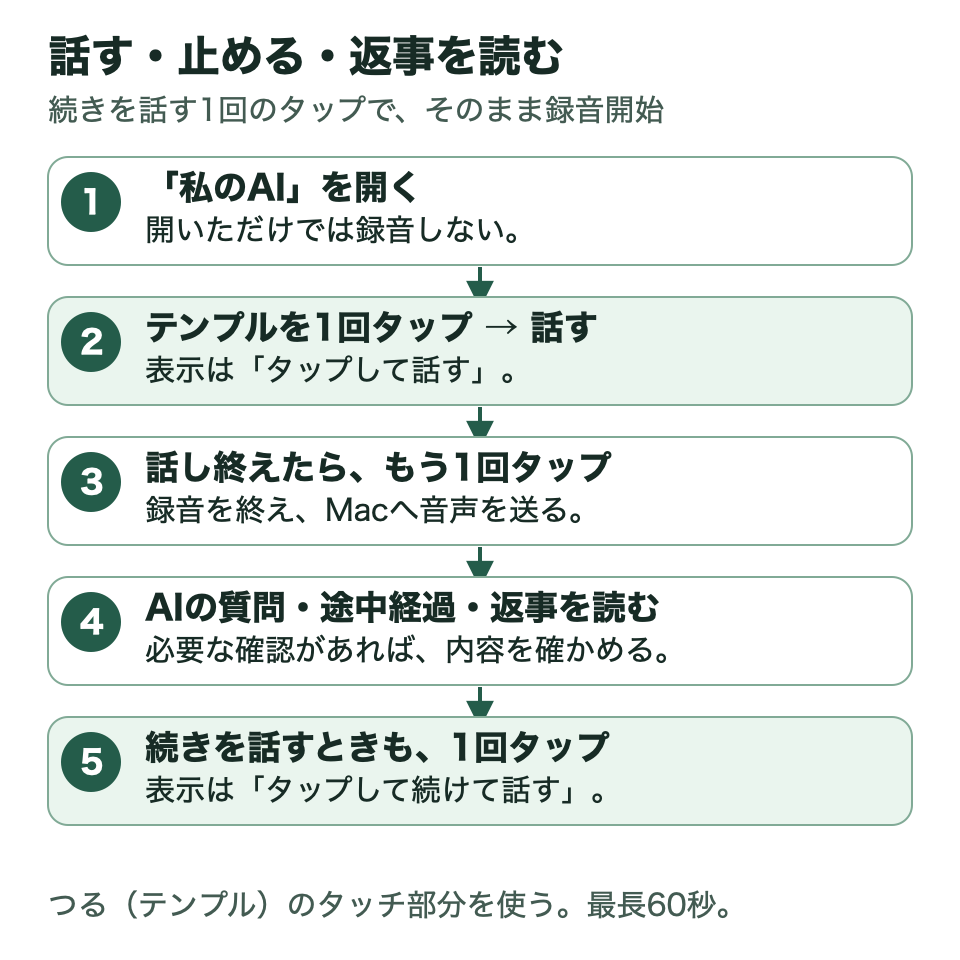
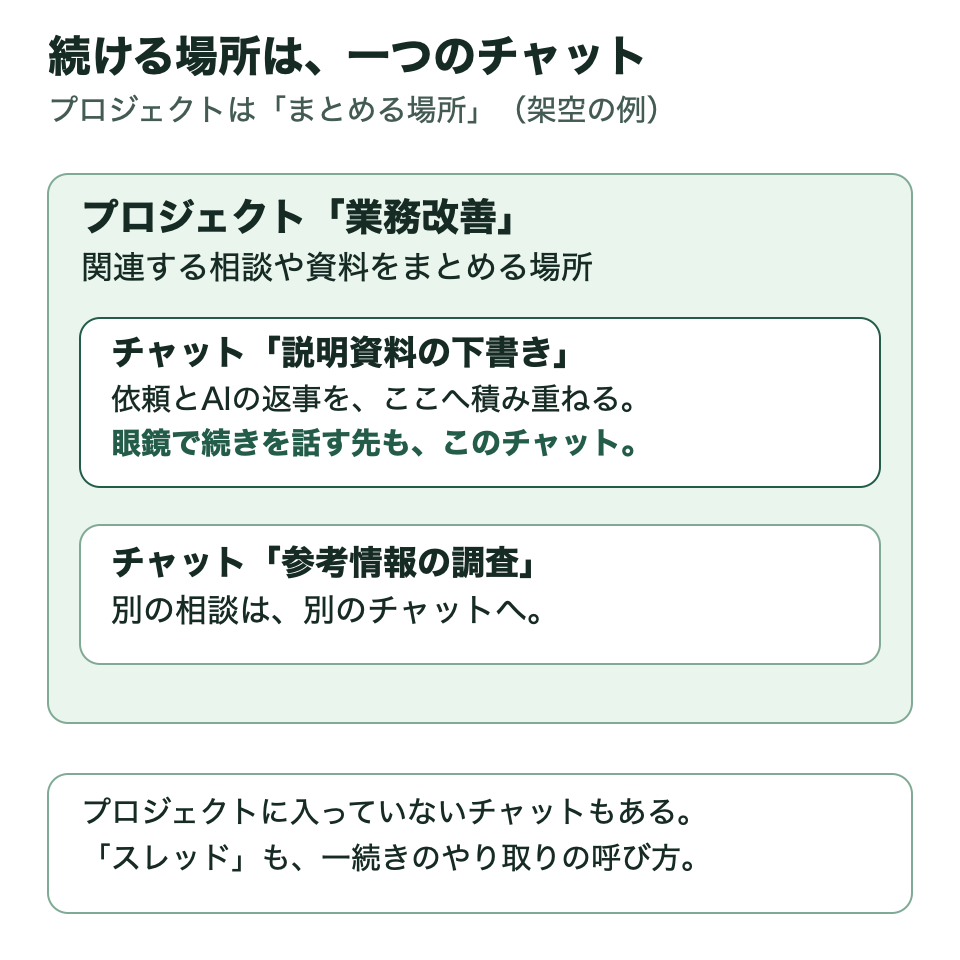

# 私のAI V2

**Macで相談していた仕事の続きを、眼鏡から声で進める。**

「私のAI」は、鈴木啓一が個人で開発している仕組みです。MacのChatGPTデスクトップアプリで進めていた相談や仕事を、Rokidのスマートグラスから声で続けられます。眼鏡にはマイクとディスプレイがあり、声で依頼して返事を読めます。作者は、調査や文書作成などを進めてもらうChatGPT Workを使っています。

このページは、作者が個人で使っている仕組みの紹介と、似た仕組みを作るための参考資料です。完成したアプリや、実際に動かしているプログラム一式は配布していません。

このページは、一般事務職の方をはじめ、プログラミングに詳しくない方に向けて書いています。何に役立つのか、どう使うのか、なぜ作ったのかを紹介します。自分でも似た仕組みを作りたい方へ、AIや開発を手伝う人と相談するための資料も用意しました。

## まずここだけ読む

### どんなことに役立つのか

Macで資料を調べたり、文書の下書きをAIと相談したりしていると、席を離れてから追加の考えが浮かぶことがあります。「さっきの資料に、この点も入れたい」と眼鏡へ話しかけて、その相談を続けられるようにしました。

AIが確認したいことを聞いてきたら、声で答えます。途中経過や返事は眼鏡に表示されます。机に戻ったら、Macで同じチャットを開き、資料を見ながら作業を続けられます。

**V2で大切にしたのは、眼鏡とMacで同じChatGPT Workのチャットを続けられることです。**

図は架空の利用例です。眼鏡とMacで、同じ相談の続きを進めます。

### どう使うのか

1. 眼鏡で「私のAI」を開き、「タップして話す」と表示されたら、眼鏡のつる（テンプル）のタッチ部分を1回タップして話します。
2. 話し終えたら、テンプルのタッチ部分をもう1回タップして録音を終えます。
3. 別の相談の続きを始めるときや、新しい相談を作るときは、画面のチャット名を確認します。
4. AIの返事を読みます。「タップして続けて話す」と表示されたら、テンプルのタッチ部分を1回タップして、続きを話します。

アプリを開いただけでは録音しません。文書を保存・編集する前には、作業を担当するAIが対象の文書と変更内容を示し、利用者に確認する設計です。

図は基本の操作の流れです。別のチャットや新しいチャットでは、本文の手順3のとおり、表示されたチャット名も確認します。

### チャット・プロジェクト・スレッドとは

ここでいうチャットは、ChatGPTの画面に残る、AIとの一続きのやり取りです。「説明資料の下書き」などの名前が付いた相談を、あとから開いて続けられます。

| 言葉 | この資料での意味 |
| --- | --- |
| チャット | 一つの相談や仕事について、依頼とAIの返事を積み重ねる場所 |
| スレッド | 一続きのやり取りを指す呼び方。この資料では「チャット」と表記する |
| プロジェクト | 関連するチャット、資料、作業の指示を目的ごとにまとめる場所 |

たとえば「業務改善」というプロジェクトに、「説明資料の下書き」「参考情報の調査」というチャットを分けて置きます。眼鏡から「説明資料の続きを考えたい」と話すと、受付役のAIが続けるチャットを提案します。別のチャットへ移るときや新しいチャットを始めるときは、利用者がチャット名を確認します。その後、そのチャットのやり取りを踏まえて相談を進めます。

**「Macで普段使っているチャット」とは、このようにChatGPTデスクトップアプリで開いて使う、個別の相談や仕事を指します。** プロジェクトに入れていないチャットもあります。

図の名前は架空の例です。プロジェクト全体ではなく、選んだチャットに話の続きを届けます。

### V1から何が変わったのか

V1でも、眼鏡からAIとのチャット、調査、確認後の文書保存ができました。V2では、**Macで普段使っているチャットを選び、これまでのやり取りや利用できる資料・道具を使って続きを進めること**を中心にしました。

### 利用には何が必要か

作者が動作を確認したのは、Rokid AI Glasses RV101とMacを使う個人環境です。

利用中は、次の状態を保つ必要があります。

- Macが起動し、ログインしていて、眼鏡とMacの間で必要な通信ができること。
- 外出先でスマホ経由で使う場合は、次の両方を満たすこと。
  - スマホがインターネットにつながっている。
  - スマホのHi Rokidアプリが起動し、眼鏡と接続して通信できる。

Bluetoothで接続したスマホの回線を利用できるため、テザリングは必須ではありません。

**この公開ページで提供するのは、考え方と作るための参考資料です。** 完成したアプリやインストーラーは配布していません。似た仕組みを作るには、自分の環境に合わせた開発と確認が必要です。

眼鏡の小さな画面では長い文書を確認しづらいため、詳しい確認や仕上げにはMacも使います。ほかの人の環境で同じように動くことは、まだ確認していません。

## 読みたいところから

ここまでで概要がわかります。以下は、関心のあるところだけ読んでください。GitHubの目次リンクは、このページ内の説明へ移動します。

- [チャットとタップの例](docs/EXPERIENCE.md)：資料調査や文書作成を、どう頼むのか。
- [コンセプトと設計の理由](docs/CONCEPT.md)：なぜ、Macの相談を眼鏡から続けるのか。
- [仕組みをやさしく説明](docs/ARCHITECTURE.md)：眼鏡とMacは、それぞれ何をするのか。
- [安心して使うための考え方](docs/SAFETY.md)：録音、保存前の確認、聞き違いをどう扱うのか。
- [確認できたこと・利用上の制約・未確認のこと](docs/VALIDATION.md)：実際に確認した範囲と制約。
- [V1とV2の違い](docs/V1_AND_V2.md)：引き継いだこと、変えたこと。

似た仕組みを作ってみたい方には、次の資料もあります。

- [自分用に作るための進め方](docs/BUILD_GUIDE.md)：最初に目的と条件を整理する。
- [AIに相談するための依頼文](docs/AI_BUILD_PROMPT.md)：自分の環境を書いて相談する。
- [詳しい仕様とデータ例](docs/REFERENCE_SPEC.md)：実装担当者向けの折りたたみ資料。

作るための資料は、必要な方だけ開いてください。コンセプトを知りたい方は読まなくても構いません。

## 公開資料について

やり取りの例は説明のために作った架空の例です。作者が実際に確認したことは、別に[確認した範囲](docs/VALIDATION.md)へまとめています。

個人のチャット、録音、文書、通信先、認証情報は掲載していません。[V1の資料](https://github.com/ksuzukigh/rokid-personal-ai)は、開発の前段階を知るために残しています。

作者：鈴木啓一（Keiichi Suzuki）。公開資料と独自の図・例は[MIT License](LICENSE)です。各社の製品や公式資料の権利は、それぞれの権利者に帰属します。各社の公式製品や公式連携ではなく、個人による参考公開です。

[参照資料](docs/REFERENCES.md) · [変更履歴](CHANGELOG.md)
