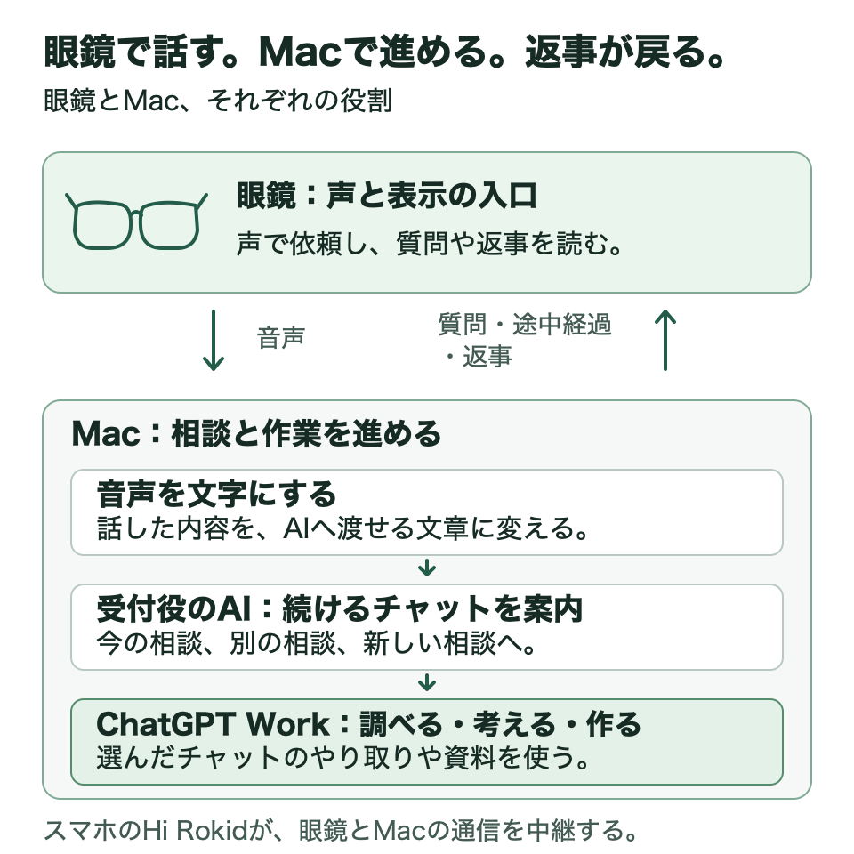
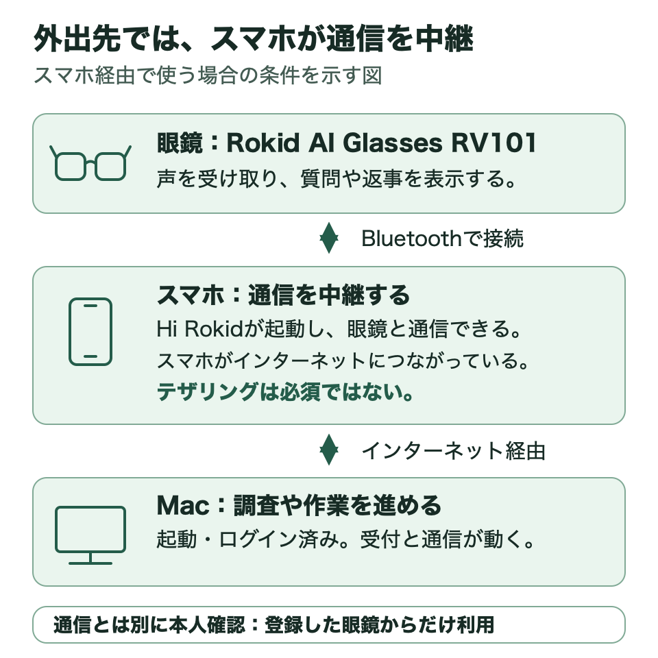

# 仕組みをやさしく説明

眼鏡は、MacのChatGPTデスクトップアプリにあるChatGPT Workのチャットへ話しかける入口です。調査や文書作成は、そのチャットで進め、返事を眼鏡へ戻します。

## 声が返事になるまで

1. **眼鏡で話す。** テンプルのタッチ部分を1回タップしたときだけ録音を始め、音声をMacへ送ります。
2. **Macで文字にする。** 話した内容を、AIへ渡せる文章に変換します。
3. **相談の続き先を選ぶ。** 受付役のAIが、今のチャットを続けるか、別のチャットか、新しいチャットかを提案します。別のチャットや新しいチャットでは、チャット名を確認します。
4. **ChatGPT Workが仕事を進める。** 選ばれたチャットで、それまでのやり取りや利用できる資料・道具を使って相談を進めます。
5. **眼鏡で返事を読む。** 途中経過、AIからの質問、最終的な返事を表示します。声で答えると、同じチャットへ戻ります。

## それぞれが担当すること

| 担当 | 役割 |
| --- | --- |
| 眼鏡 | 声を受け取り、チャット名や返事を表示する |
| Mac側の通信・記録の仕組み | 登録した眼鏡からの通信かを確認し、依頼や表示の状態を記録する |
| 音声を文字にする仕組み | Macの中で文字起こしをする。処理後に録音した音声を削除する |
| 受付役のAI | どの相談を続けるかを案内する。文書を編集する仕事はしない |
| ChatGPT Workのチャット | 調べる、考える、文書を作るなど、実際の相談や作業を進める |

利用できる資料やサービスは、自分が接続した範囲に限られます。作者は、メモや資料を保存するObsidianと、Google Driveの文書などを使っています。

## 外出先から使うには

スマホ経由で、自宅などにあるMacへ通信を届けます。次の状態が必要です。

図はスマホ経由で使う場合の通信の流れです。

- スマートフォンが、携帯電話回線やWi-Fiでインターネットにつながっている。
- スマートフォンでHi Rokidアプリが起動し、眼鏡と接続して通信できる状態になっている。

AIUIの公式資料では、眼鏡のWi-Fiが未接続でも、Bluetoothでつながったスマホのアプリがオンラインなら、スマホの回線で通信できると説明されています。テザリングは必須ではありません。[AIUI公式の通信説明](https://github.com/yodaos-project/AIUI/blob/main/documentation/0-guide/basic/network/usage.en-US.md)

Mac側にも通信を受け取る仕組みが必要です。作者の環境ではCloudflare Tunnelという仕組みを使っています。これで通信を届けることと、接続した眼鏡が本人のものか確かめることは、別に扱います。

## チャットを取り違えないために

Mac側の仕組みは、どの依頼を、どのチャットへ送ったか、送信がどこまで進んだか、どんな結果が返ったかを、ひとまとまりの記録として残します。通信が途切れても、同じ依頼の結果を探し、むやみに送り直さないためです。

眼鏡に表示した質問も覚えておきます。古い質問への返事を、別の新しい質問への同意として使うことを防ぎます。

## 自分用に作るときの注意

作る順序や接続方法は、[自分用に作るための進め方](BUILD_GUIDE.md)にまとめています。

詳しい部品の仕様やデータ例は、[実装を担当する方向けの資料](REFERENCE_SPEC.md)にまとめています。

[コンセプト](CONCEPT.md) · [自分用に作るための進め方](BUILD_GUIDE.md) · [トップへ](../README.md)
