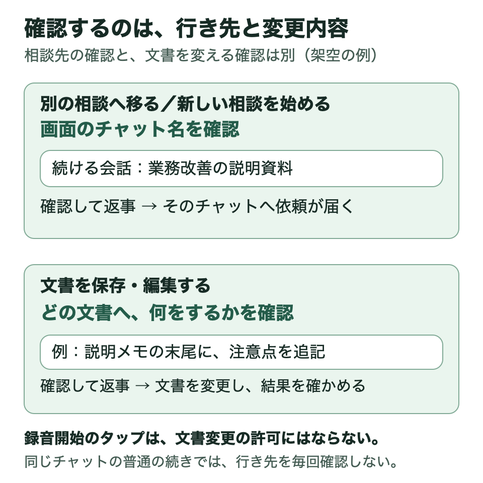

# 安心して使うための考え方

相談先を変えるときはチャット名を、文書を保存・編集するときは対象と内容を確認します。

図のチャット名と追記内容は架空の例です。相談の行き先への同意を、文書を変える許可として使い回しません。

## 開いただけでは録音しない

「タップして話す」または「タップして続けて話す」の画面で、テンプルのタッチ部分を1回タップして話します。録音中はその状態が表示されます。話し終えたら、もう1回タップして録音を終えます。録音は最長60秒です。

録音した音声と、文字起こし用の一時音声は、処理後に削除します。失敗や取消の場合も削除を確認する設計です。文字にした発言とAIとのチャット履歴は残ります。

## 聞き違いを、そのまま同意にしない

音声を文字にする前に、人の声がある区間を確かめ、無音から誤った文章が生まれることを減らしています。ただし、周囲の人やテレビの声を完全に除けるわけではありません。

確認待ちの返事が文脈に合わないときは、元の依頼を保持して聞き直します。確認するときは、画面のチャット名や内容を確かめて答えます。

## 相談の続き先を確認する

別のチャットへ移るときや新しい相談を作るときは、Macで確かめた実際のチャット名を画面に表示します。

また、Macから先に相談を進めたために眼鏡の質問が古くなった場合、古い質問への「はい」を新しい質問の承認には使いません。最新の内容を表示します。

## 文書を変更する前に確認する

保存や編集の前には、どの文書へ、何をするかを示して確認を受けます。確認後に対象や本文が変われば、改めて確認します。録音を始めるためのテンプルのタップや、相談先チャットへの同意を、文書変更の許可には使いません。

送信や公開などを扱う場合も、対象と内容を確認してから進める方針です。操作ごとの確認状況は、[確認した範囲](VALIDATION.md)にまとめています。

実行後は、保存先の文書を開き、指定した内容が反映されたか確かめます。

## 返事がないときに、同じ仕事を繰り返さない

通信が切れた場合、依頼が届かなかったのか、届いて仕事が進んでいるのか、その時点ではわからないことがあります。そこで、まず同じ依頼の状態を確かめます。返事がないという理由だけで送り直すと、文書などを二重に作るおそれがあるためです。

エラーが出た場合も、実際の保存先を確認します。

## 接続と資料の扱いを決める

本人が登録した眼鏡からだけ利用できるようにし、登録を解除できるようにします。通信を届ける仕組みとは別に、利用者や端末を確認します。

認証情報を公開資料や配布用のファイルへ入れません。資料やサービスの利用範囲も、自分が許可した範囲にします。職場の資料を使う場合は、その職場で認められたAIや保存先、資料の扱いを前提に、自分の用途を検討します。

[確認した範囲と制約](VALIDATION.md) · [実装を担当する方向けの詳しい仕様](REFERENCE_SPEC.md) · [トップへ](../README.md)

[自分用に作るための進め方](BUILD_GUIDE.md)
