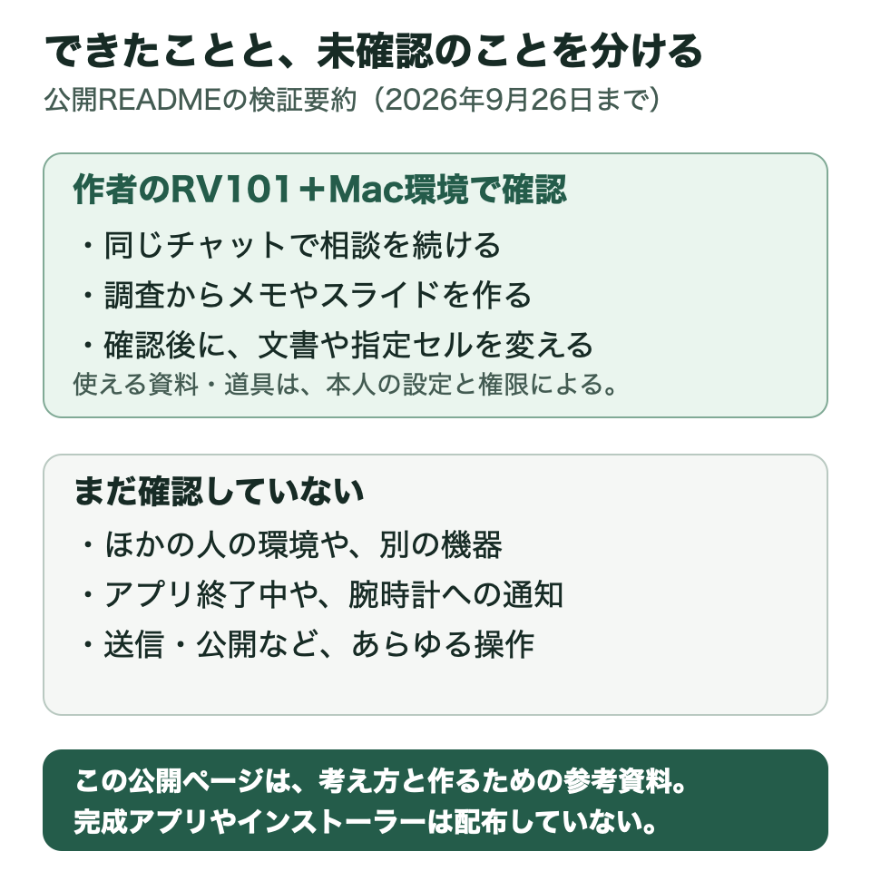

# 確認できたこと・利用上の制約・未確認のこと

作者のRokid AI Glasses RV101と、ChatGPTデスクトップアプリのChatGPT Workを使うMac環境で、2026年9月26日までに確かめた内容を紹介します。公開資料の初版は2026年10月10日です。

ほかの人の環境での再現は、まだ確認していません。



図は、作者のRV101とMacで確かめたことと、未確認のことをまとめたものです。

## 実際に確かめたこと

| 利用場面 | 確かめた内容 |
| --- | --- |
| 相談の続きを始める | 声で頼んで実際のMacのチャットを選び、返事を眼鏡で読めた |
| 新しい相談を始める | チャット名を確認して新しいMacのチャットを作り、最初の返事を眼鏡で読めた |
| 作業の経過を読む | 途中経過から最終回答へ表示が更新され、同じ報告でのちらつきを抑えた |
| AIの質問へ答える | 眼鏡に表示された質問へ声で答え、同じMacのチャットへ返事が届いた |
| Macからも相談を進める | 作業中にMacから追加した内容が反映され、最終回答が眼鏡へ戻った |
| メモや文書を扱う | Obsidianでの文書の読み取り、新規文書の作成、既存文書への追記・編集を、確認後に行い、実際の本文を確かめた |
| Googleの文書や表を扱う | Google Driveの検索、確認後のGoogleドキュメント作成・追記、スプレッドシートの指定セル更新を確かめた |
| 調査から資料作成まで進める | 声で依頼し、Web調査、Obsidianの新規文書、Googleスライド作成まで一巡した |
| 古い質問を取り違えない | Macなどでチャットが先に進んだ場合、古い質問への返事を送らず、最新の内容を表示した |
| 通信が切れた後に戻る | 実際の音声を受け付けた後に通信を1回切り、依頼を二重に送らず返事を取り戻した |
| 再起動後に戻る | Macの受付の自動起動と、Mac・眼鏡の再起動後のチャット復旧を確かめた |
| 終了後に音声を残さない | 原音と一時音声が残らず、その回の接続が終わったことを確かめた |

眼鏡で「私のAI」を開いたままにすると、Mac側で追加された新しい質問が眼鏡にも表示されることを、作者本人が確認しています。ただし、「私のAI」を終了した状態で眼鏡に通知が届くことは確認していません。

利用できる資料やAIは、アカウントと設定によって変わります。

## 利用するときの制約

- Macが起動してログインしており、受付と通信が動いている必要があります。
- スマホ経由で使う場合は、スマホがインターネットにつながり、Hi Rokidアプリが起動して、眼鏡と接続・通信できる状態が必要です。
- 長い文書や複雑な確認には、Macなどの大きな画面も使います。
- 音声認識には聞き違いがあります。周囲の声を完全に取り除けるわけではありません。
- AIやGoogle Driveなどの利用範囲は、自分のアカウントと許可した範囲に依存します。
- 普段のMacのチャットへつなぐ部分は、使っているアプリや版が変わると見直しが必要になる場合があります。

## まだ確認していないこと

- ほかの人が最初から作って使うこと、別のアカウントで同じ接続ができること。
- RV101以外の眼鏡、WindowsやLinux、作者と異なるMac構成での同じ動作。
- 送信、公開、共有、削除、購入、予定登録など、あらゆる種類の操作。
- 「私のAI」を終了した状態での眼鏡への通知や、腕時計への通知・操作。
- すべての通信断や、同時に別の場所から入力する場合の組合せ。
- 長期間の互換性、電池への影響、端末からの認証情報の抜き取りに対する強さ。

## どう確かめたか

実際に声で依頼し、作者本人が眼鏡の表示を確認しました。Macへ届いた記録、作成・編集された文書、処理後の音声削除も合わせて確かめています。

この資料は、作者本人の検証記録をまとめたものです。

<details>
<summary>自分用に作る方へ：確認記録の書き方と版の情報</summary>

作者の確認対象は個人用Agent版0.36.13までです。チャット先の実名表示、作業AIの実モデル表示と切替、指定した標準モデルの区別も確認しています。Googleの文書や表の変更後は、本文・セルと、二重に作られていないことを読み戻しました。

自分の環境では、次のように記録すると、何を確かめたかを後から判断しやすくなります。

```text
確認日：
使った眼鏡・Mac・AIアプリと、その版：
試した体験と条件：
机上の確認／Macだけの確認／眼鏡での確認：
話したこと、実際のチャット先、眼鏡に表示されたこと：
変更した文書など、事前の確認、実行後に確かめた結果：
同じ依頼が二重に届いていないか：
終了後の音声と接続の片付け：
できたこと、失敗したこと、まだ確かめていないこと：
```

</details>

[自分用に作るための進め方](BUILD_GUIDE.md) · [トップへ](../README.md)
